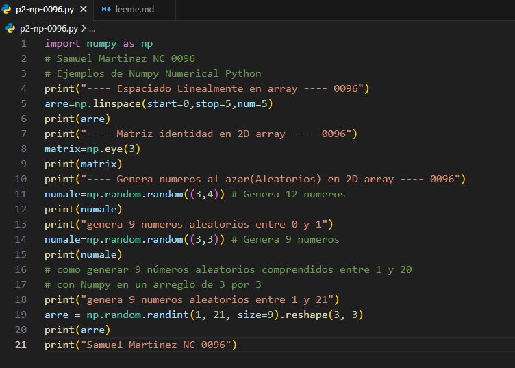
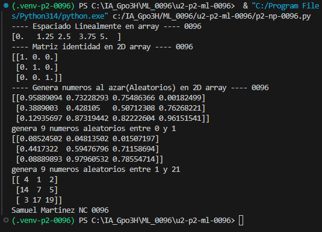

"start=0:" indica el número donde comienza el intervalo.

"stop=1:" indica el número donde termina el intervalo.

"num=5:" indica que se generarán 5 números en total.

## que es np.linespace
np.linspace() genera una serie de números con la misma separación entre ellos, dentro de un intervalo que tú eliges.

## El codigo

## Resultado
